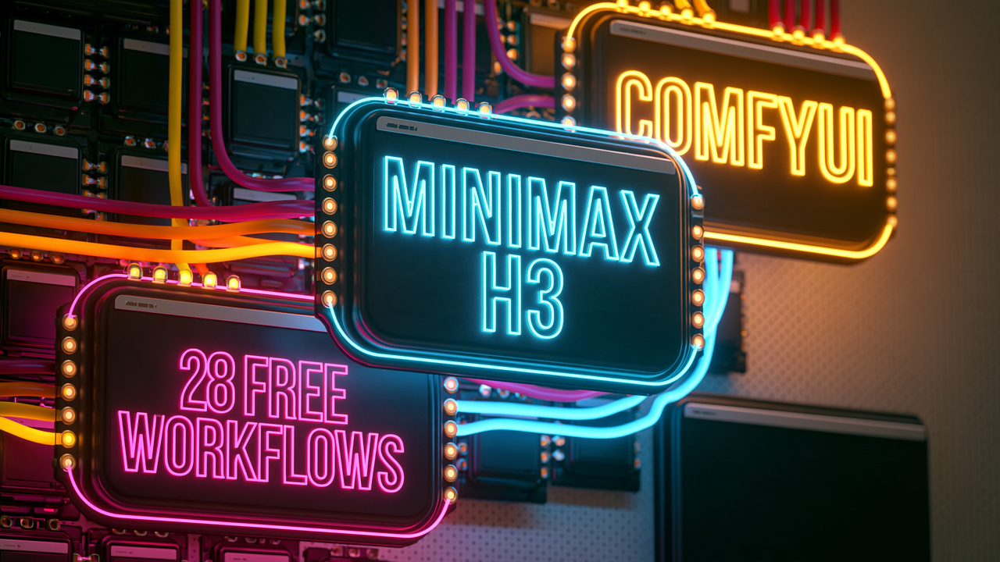
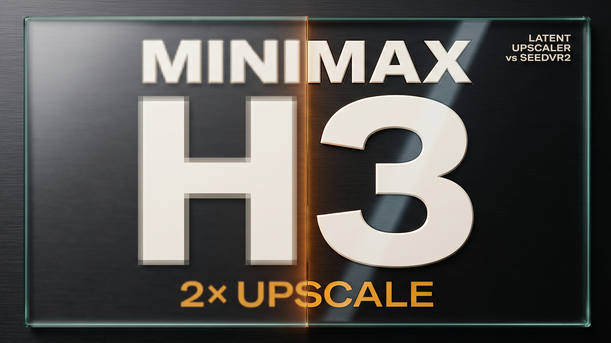
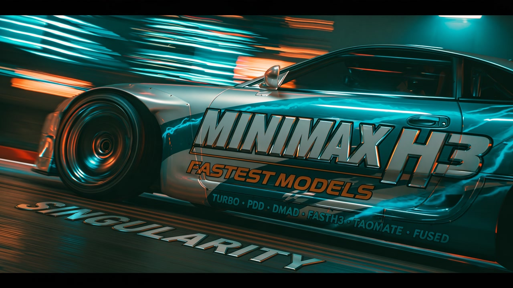
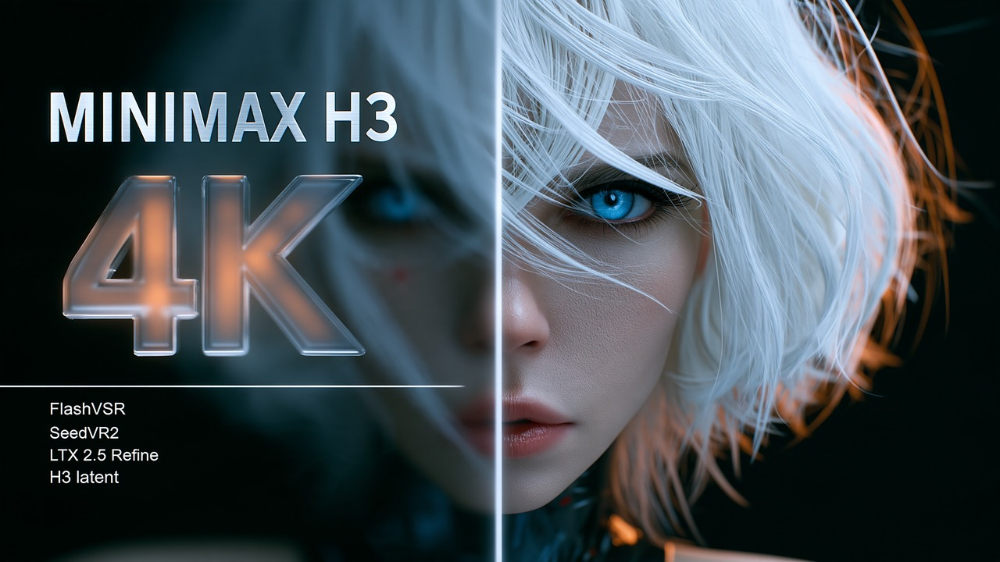

# ComfyUI workflows from my videos

Free. Download a file and drop it into ComfyUI.

**For any issues, comment on the YouTube videos. I will be happy to help.** Issues and pull requests are closed here.

## The workflows

| Video | Workflows |
|---|---|
|  [MiniMax H3 latent upscaler vs SeedVR2 3B: which 2× upscale? (RTX 4090, ComfyUI)](https://youtu.be/2sZnNi08KMQ) | **2x upscale** (`workflows/upscale_2x/`) `2x_h3_latent_upscaler.json` · `2x_seedvr2.json` |
|  [MiniMax H3 Fastest Models Tested: FastH3 vs Turbo vs Singularity](https://youtu.be/s4pJLt1P4Rg) | **Text only** (`workflows/text/`) `text_dmad_4step.json` · `text_fasth3_trim.json` · `text_fasth3_v1.json` · `text_fasth3_v2.json` · `text_taomate_3step.json`  **References** (`workflows/references/`) `ref_fasth3_omni.json` · `ref_fused.json` · `ref_minimax_h3.json` · `ref_pdd_8step.json` · `ref_pika_flex.json` · `ref_singularity.json` · `ref_turbo_4step.json` · `ref_turbo_8step.json` · `ref_vdn_makers_recipe.json` · `ref_vdn_saganaki22_node.json`  **First frame** (`workflows/first_frame/`) `ff_fused.json` · `ff_minimax_h3.json` · `ff_pdd_8step.json` · `ff_pika_flex.json` · `ff_turbo_4step.json` · `ff_turbo_8step.json` |
|  [Best MiniMax H3 4K Upscaler? FlashVSR vs SeedVR2 vs LTX vs H3 Latent](https://youtu.be/ZsBhA2_RvH0) | **4K upscale** (`workflows/upscale_4k/`) `flashvsr_4k.json` · `h3_latent_upscaler_4k.json` · `ltx_refine_4k.json` · `seedvr2_4k_join_pieces.json` · `seedvr2_4k_one_piece.json` |
|  [Pika H3 Flex vs FastH3 Omni vs Singularity V2 vs Turbo: MiniMax H3 Fastest Models v2 (RTX 4090)](https://youtu.be/7Vss2ahYExo) | **Text only** (`workflows/text/`) `text_fasth3_trim.json` · `text_fasth3_v1.json` · `text_fasth3_v2.json`  **References** (`workflows/references/`) `ref_fasth3_omni.json` · `ref_fused.json` · `ref_minimax_h3.json` · `ref_pdd_8step.json` · `ref_pika_flex.json` · `ref_pika_flex_turbo_2step.json` · `ref_pika_flex_turbo_4step.json` · `ref_pika_flex_turbo_8step.json` · `ref_singularity.json` · `ref_turbo_4step.json` · `ref_turbo_8step.json` · `ref_vdn_makers_recipe.json` · `ref_vdn_saganaki22_node.json`  **First frame** (`workflows/first_frame/`) `ff_fused.json` · `ff_minimax_h3.json` · `ff_pdd_8step.json` · `ff_pika_flex.json` · `ff_pika_flex_turbo_4step.json` · `ff_pika_flex_turbo_8step.json` · `ff_turbo_4step.json` · `ff_turbo_8step.json` |

## What you need

Every model and node pack, with its link and its folder: `LINKS.md`. The workflows' loaders carry the same model links.

## Good to know

- **Machine:** RTX 4090 24 GB, 96 GB RAM, Windows 11. Built on ComfyUI v0.42.5.
- **LTX-2.5:** Lightricks' model repos ask you to press Agree and Access on Hugging Face first.
- **SeedVR2 at 4K:** run `seedvr2_4k_one_piece.json` with batch count 4, then `seedvr2_4k_join_pieces.json` joins the pieces.
- **Not checked one last time:** TaoMate 3-step, DMAD 4-step and SeedVR2 at 2x. I deleted those models, because I wasn't happy with the results and I needed the disk space. These workflows should run, but I did not run them again before sharing them.
- **Labels:** `VDN-H3, Saganaki22's node` is Saganaki22's port on the Ref2VA weights, not the makers' trained path.

## Credits

MiniMax H3 by MiniMax · FastH3 by FastVideo (v1's int8 file by Kijai) · Turbo LoRAs by lightx2v · PDD LoRAs by Alibaba PAI · Singularity by the AIGC-Singularity team · fused by MATLOWAI · Pika H3 Flex by Pika Labs · Pika Flex Turbo merges by akhaliq, hosted by Pika Labs · VDN-H3 by OpenVDN, node by Saganaki22 · TaoMate by TaoLiveAIGC · DMAD by ZhengmingYu · SeedVR2 by ByteDance Seed, node pack by numz · FlashVSR by its makers, node pack by Pizzawookiee · H3 latent upscaler by LBH-123-AI · LTX-2.5 by Lightricks · KJNodes by Kijai · ComfyUI and its repacks by Comfy-Org

## Licence

The workflow files and these documents are MIT (`LICENSE`). That covers only those files: the thumbnails in `images/` are not included, and each model and node pack keeps its own licence, so read it on its page before you use it.
